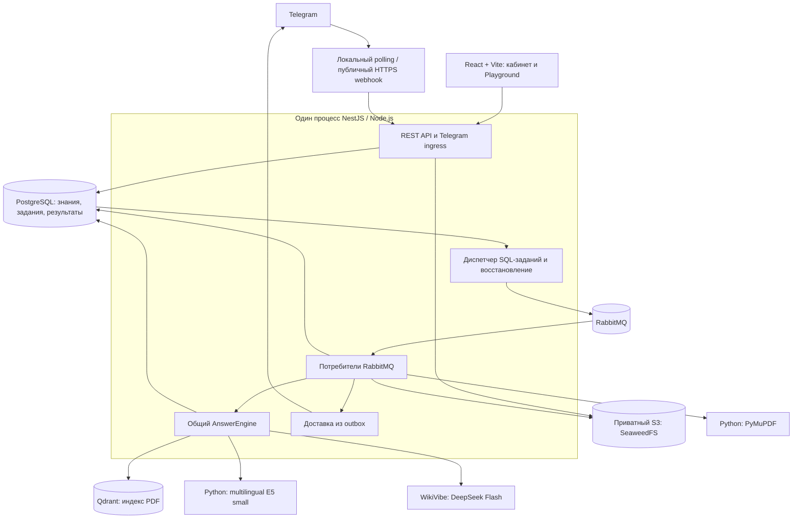

# OpenFacto

Telegram-first платформа ответов для мероприятий. Организатор публикует FAQ и PDF,
проверяет ответы в Playground и обрабатывает обращения, требующие решения человека.
Участники задают вопросы Telegram-боту на русском, казахском и смешанном языке.

Текущая реализация на **8 ноября 2026**: NestJS, общая очередь AI в RabbitMQ,
DeepSeek Flash через WikiVibe, локальные E5 embeddings и проверка ответа по опубликованным знаниям.
Кабинет включает обзор, источники, Playground, обращения и настройки в адаптивной графитовой теме.

[Полная текущая архитектура и pipeline](docs/openfacto/CURRENT-ARCHITECTURE.md) ·
[Документация](docs/openfacto/README.md) · [Запуск и диагностика](docs/openfacto/RUNBOOK.md)

## Архитектура

API и фоновые Node-обработчики работают **в одном NestJS-процессе**.
`apps/worker` — библиотека обработчиков. Извлечение PDF и локальный семантический поиск
используют отдельные Python-процессы.



| Компонент | Технологии и роль |
| --- | --- |
| Интерфейс | React, TypeScript, Vite, CSS, Motion, Phosphor |
| Backend | NestJS, Node.js, REST API, сессии и роли |
| Основные данные | PostgreSQL 18, Drizzle, SQL-миграции; версии знаний, права, задания, история, расходы |
| Очереди | RabbitMQ 4, amqplib; доставка уведомлений о сохранённых SQL-заданиях |
| Поиск FAQ | Заголовки и алиасы, локальные векторы в PostgreSQL `faq_embeddings` |
| Поиск PDF | Qdrant: dense/sparse выдача, объединение RRF, фильтры организации, мероприятия и версии |
| Embeddings | `intfloat/multilingual-e5-small`, 384 измерения; Python, PyTorch CPU, sentence-transformers |
| Выбор и проверка ответа | `deepseek-v4.1-flash` через WikiVibe; независимые запросы выбора и проверки |
| Файлы | Приватный SeaweedFS S3; PyMuPDF извлекает постраничный текст |
| Разработка | pnpm, Turborepo, Docker Compose, Vitest, Node test runner, Oxlint, TypeScript |

Коллекция Qdrant определяется embedding-моделью; мероприятия разделяются фильтрами.
Текст и разрешение на его использование повторно проверяются в SQL после поиска.
Нейронный reranker реализован как опция, но в текущем профиле выключен (`RERANK_URL` пуст).

## Pipeline вопроса

1. **Приём.** Telegram ingress сохраняет сообщение в inbox. Playground сохраняет задание,
   возвращает HTTP `202` с ID запроса, затем браузер получает результат опросом GET статуса.
2. **Общая очередь.** Диспетчер публикует ID сохранённой работы в `ai.questions`.
   Обработчики обоих каналов вызывают один AnswerEngine.
3. **Контекст и быстрые ответы.** Проверяются область доступа, история и кэш.
   Приветствия, однозначный утверждённый FAQ и некоторые короткие продолжения обходятся без LLM.
4. **Поиск.** Для остальных вопросов объединяются FAQ, опубликованный текст из PostgreSQL
   и фрагменты PDF из Qdrant. E5 помогает искать по смыслу на разных языках.
5. **Выбор и проверка.** DeepSeek определяет намерение, язык и подходящие доказательства.
   Программные проверки контролируют ссылки и точность цитат; отдельный запрос к модели
   проверяет соответствие ответа источникам. При недостаточной выдаче допустимо одно расширение поиска.
6. **Решение.** Движок возвращает ответ, уточнение или передачу модератору.
   Условия и исключения не додумываются; перед выдачей снова проверяется актуальность публикации.
7. **Результат.** Playground показывает сохранённое решение. Telegram получает ответ через
   SQL outbox и очередь доставки. Trace сохраняет основание, этапы, время и AI-расходы.

Поддержка смешанной речи включает ограниченную нормализацию известных казахских слов:
`тіркелу` / `тиркелу` / `tirkelu`, `қайда` / `кайда` / `qaida`.
Короткое «а во ск» использует тему истории только при однозначном FAQ с явно указанным временем.
Отрицания, новые условия и просьбы об исключении сохраняются для обычной проверки.

В Telegram история ограничена последними тремя парами вопрос/ответ и TTL 10 минут,
с разделением по боту, чату, теме и участнику. Ответы кэшируются в памяти процесса
до 60 секунд с учётом контекста, настроек и публикаций; изменение знаний инвалидирует кэш.

### Очереди и восстановление

| Очередь | Задания | Параллелизм на backend в текущем профиле |
| --- | --- | ---: |
| `ai.questions` | Telegram и Playground | 2, общий для обоих каналов |
| `documents.ingest` | Обработка и удаление индекса, embeddings FAQ | 1 |
| `messages.delivery` | Telegram outbox | 2 |
| `ai.evaluations` | Контрольные прогоны качества | 1 |

PostgreSQL хранит состояние работ, leases и записи отправки в брокер. RabbitMQ использует
publisher confirms и manual ack. Восстановление повторно поднимает незавершённые работы;
семантика доставки — **at least once**, с защитой от повторной обработки через SQL.
Для некорректных сообщений и необработанных ошибок предусмотрены очереди `.dead`.
В брокере передаются ID, а не тексты вопросов, PDF или токены.

### Подготовка знаний

**FAQ:** черновик → проверка организатором → публикация версии → индекс заголовка и алиасов.
Точный ответ берётся из утверждённого текста. Вектор FAQ хранится в PostgreSQL.

**PDF:** приватный S3 → версия и задание в SQL → `documents.ingest` → PyMuPDF →
постраничный текст → чанки → текст в SQL и векторы в Qdrant → готовность → публикация.

Чанкинг учитывает абзацы, предложения, списки, таблицы и заголовки; целевой размер —
**1000 символов**. Перекрытие 120 символов используется при вынужденном разрезании очень
длинных предложений. Страницы сохраняются для цитат; поиск может добавить соседние чанки той же страницы.
Сканам без извлекаемого текста требуется OCR/текстовая версия: OCR в текущий парсер не входит.
Это RAG: документы используются как контекст поиска, а не для дообучения DeepSeek.

## Локальный запуск

Требуются **Node.js 24+** (поддерживается `<27`), **pnpm 12.17.0**, **Python 3.12**,
**uv** и **Docker Compose**. Semantic runtime требует Python `<3.13`.
Команды ниже выполняются из корня проекта в PowerShell.

### 1. Окружение и зависимости

```powershell
if (!(Test-Path .env)) { Copy-Item .env.example .env }
if (!(Test-Path apps/mini-app/.env)) { Copy-Item apps/mini-app/.env.example apps/mini-app/.env }
pnpm install --frozen-lockfile
pnpm python:sync
uv sync --locked --project apps/semantic-worker
```

Заполните серверный `.env`:

| Настройка | Для чего |
| --- | --- |
| `DATABASE_URL`, `RABBITMQ_URL`, `QDRANT_URL`, `S3_*` | Адреса и доступ к выбранной локальной инфраструктуре |
| `AI_PLATFORM_KEY` | Ключ провайдера WikiVibe |
| `AI_CHAT_ENDPOINT` | `https://api.wikivibe.dev/v1/chat/completions` |
| `AI_CHAT_MODEL` | `deepseek-v4.1-flash` |
| `AI_VERIFY_MODEL` | Пусто: проверка отдельным запросом к той же модели |
| `AI_THINKING_MODE` | `disabled` в текущем профиле |
| `PDF_WORKER_TOKEN` | Случайный секрет от 32 символов, одинаковый у backend и PDF worker |
| `BOT_ENCRYPTION_KEY` | Ключ шифрования токенов ботов: 32 случайных байта в Base64 |

Получить новый ключ шифрования можно командой
`node -e "console.log(require('node:crypto').randomBytes(32).toString('base64'))"`
и сохранить вывод в `.env`. Для существующих ботов сохраняйте прежний ключ.
AI-ключи и Telegram-токены остаются в серверном окружении; переменные `VITE_*` публичны.
Тарифы `AI_*_MICROS_PER_1K` используются для локального учёта, фактическое списание определяет провайдер.

### 2. Модели и инфраструктура

```powershell
apps/semantic-worker/.venv/Scripts/python.exe apps/semantic-worker/models.py
$env:HF_HUB_OFFLINE='1'
$env:TRANSFORMERS_OFFLINE='1'
apps/semantic-worker/.venv/Scripts/python.exe apps/semantic-worker/benchmark.py
node scripts/configure-semantic.mjs --apply
pnpm infra:up
pnpm build
pnpm db:migrate
```

Первое скачивание весов требует сети. После подготовки модели обслуживаются локально.
`configure-semantic.mjs --apply` выбирает настройки по benchmark и записывает semantic-профиль в `.env`.
Подробности — в [README semantic worker](apps/semantic-worker/README.md).

Новая установка использует порты из `.env.example` и `compose.yaml`.
Для уже существующего стенда согласуйте адреса с его контейнерами: например, текущий QA PostgreSQL
использует `55432`, а шаблон — `5432`. Не подменяйте существующие credentials шаблонными.

### 3. PDF worker и кабинет

В отдельном терминале:

```powershell
uv run --locked --directory apps/pdf-worker --env-file ../../.env python -m openfacto_pdf
```

В основном терминале:

```powershell
$env:LOCAL_APP_PORT='55273'
pnpm dev:local
```

Кабинет: [http://127.0.0.1:55273](http://127.0.0.1:55273).
Готовность API: [http://127.0.0.1:53000/health/ready](http://127.0.0.1:53000/health/ready).
`dev:local` включает локальный демонстрационный вход, запускает backend и Vite,
а также запускает или переиспользует подготовленный semantic service на `7312`.
PDF worker запускается отдельно.

Без `LOCAL_APP_PORT` скрипт выбирает `55173`; на текущей Windows этот порт зарезервирован,
поэтому выше указан `55273`. Для разработки с watch-режимом есть `pnpm dev`
(UI `localhost:5173`, API `127.0.0.1:3000`; отдельная настройка входа).
Локальный demo-вход предназначен для разработки; для обычного Telegram-входа нужен Manager Bot.

### 4. Telegram

В настройках кабинета подключите отдельного бота мероприятия, разрешённую группу и имена активации.
Групповые обращения поддерживают `/ask`, упоминание, ответ на сообщение бота и настроенное имя,
например «лол». Для обычных обращений по имени Telegram должен передавать сообщения группы
(настройка Privacy Mode в BotFather).

Для локального входа можно запустить один receiver:

```powershell
node --env-file=.env scripts/telegram-polling.mjs 'BOT_UUID'
```

Замените `BOT_UUID` на ID записи бота в OpenFacto. Receiver должен использовать ту же базу и
`BOT_ENCRYPTION_KEY`, что и backend. Polling и публичный webhook одновременно не используются.
Порядок подключения — [локальный Telegram](docs/openfacto/LOCAL-TELEGRAM.md).
Для production-входа настройте `MANAGER_BOT_TOKEN`, публичные HTTPS-адреса и webhook
по [runbook](docs/openfacto/RUNBOOK.md).

## Проверки и скорость

```powershell
pnpm check                     # lint, typecheck, JS/TS-тесты, build
pnpm python:lint
pnpm python:test
pnpm python:smoke
```

Интеграционные наборы: `pnpm test:integration`, `pnpm python:test:integration`.
Запускайте их с изолированными тестовыми базой/очередями и нужными сервисами по
[runbook](docs/openfacto/RUNBOOK.md), чтобы рабочий consumer не забирал тестовые задания.
`pnpm test:e2e` запускает HTTP e2e-тесты API; `pnpm verify:local` создаёт временные
fixtures и проверяет в том числе сбои зависимостей — ему нужен отдельный стенд.

Последний [отчёт исправления смешанного языка](docs/openfacto/FAQ-WORDING-FIX-2026-11-08.md), 8 ноября 2026:

| Проверка | Результат |
| --- | ---: |
| `pnpm check`, JS/TS-тесты | 295/295; lint, types и build прошли |
| Основной живой набор: опечатки, мат, смешанный язык, PDF, исключения | 40/40 |
| Повторы исправленных случаев и дополнительные варианты | 48/48, без AI-вызовов |
| Затронутые AI/SQL-интеграции | 6/6 |
| Холодные запросы через HTTP → RabbitMQ → обработчик | 3/3 |

| Измерение | Задержка |
| --- | ---: |
| Исправленные быстрые пути, только движок | Медиана 3 мс, p95 12 мс |
| Три холодных HTTP-запроса Playground | 148–303 мс |
| Полный смешанный набор из 40 вопросов, включая LLM | Медиана 2,61 с, p95 8,24 с |

Это результаты конкретного локального прогона. Время Telegram дополнительно включает сеть и доставку.
Быстрые FAQ ускорены без новых AI-вызовов; общий p95 модельных запросов в сравнении не улучшился.
Прохождение набора не гарантирует понимание любой смешанной речи.

## Структура и документация

```text
apps/api/              NestJS API и подключение фоновых обработчиков
apps/worker/           Библиотека AI, индексации, доставки и evaluation workers
apps/mini-app/         React/Vite кабинет
apps/pdf-worker/       Python / PyMuPDF
apps/semantic-worker/  Локальные embeddings и опциональный reranker
packages/answer-engine/ Общая логика ответов и проверок
packages/database/    Drizzle, SQL и миграции
scripts/              Запуск, polling, настройка и проверки
docs/openfacto/       Архитектура, контракты, runbook и отчёты
```

- [Полная текущая архитектура](docs/openfacto/CURRENT-ARCHITECTURE.md): потоки, хранение, RAG, очередь, контекст, безопасность.
- [AI pipeline](docs/openfacto/AI-PIPELINE.md) и [разговорный AI](docs/openfacto/CONVERSATIONAL-AI.md).
- [API](docs/openfacto/API.md), [модель данных](docs/openfacto/DATA-MODEL.md), [ADR](docs/openfacto/ADR.md).
- [Модель угроз](docs/openfacto/THREAT-MODEL.md), [проверки](docs/openfacto/VERIFICATION.md), [backlog](docs/openfacto/BACKLOG.md).
- [Проверка графитового интерфейса](docs/openfacto/GRAPHITE-UI-CHECK-2026-11-08.md).
- [Сравнение моделей DeepSeek](docs/openfacto/DEEPSEEK-CHECK-2026-11-08.md): исторический прогон до последнего исправления FAQ.

Для обновления старой установки с BullMQ сначала остановите прежние consumers,
настройте RabbitMQ и примените миграции `0010_async_playground` / `0011_queue_dispatches`
по [инструкции перехода](docs/openfacto/RUNBOOK.md#переход-с-bullmq-на-rabbitmq).
Незавершённые работы восстанавливаются из SQL; прежние Redis-данные автоматически не удаляются.

Исходный [архитектурный proposal v2.0](<docs/Openfacto — Полная архитектура проекта (v2.0).md>)
сохранён как исторический документ. Текущее устройство описано в `CURRENT-ARCHITECTURE.md`.
