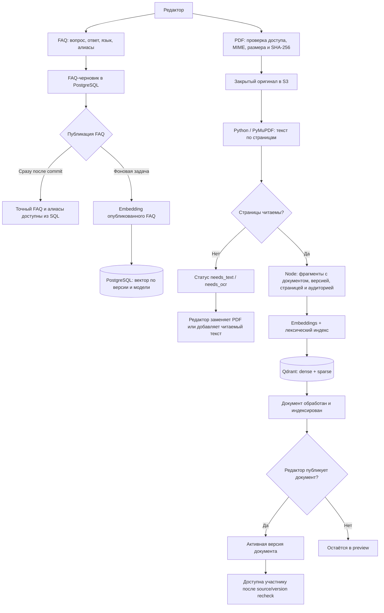
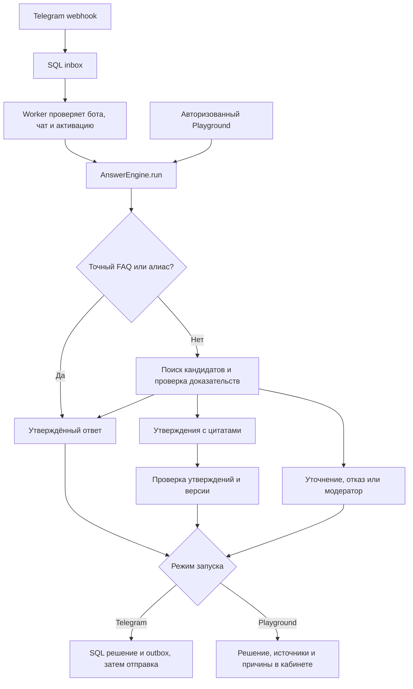

# Как OpenFacto выбирает ответ

Разговорные запросы, смешанная RU/KK речь, история диалога и локальный запуск описаны в [CONVERSATIONAL-AI.md](CONVERSATIONAL-AI.md). По умолчанию после промаха точного FAQ выполняется поиск по исходному вопросу, затем один модельный этап одновременно определяет смысл, язык и подходящие источники. Независимый этап `verify` и программная проверка цитат сохраняются. Если доказательств недостаточно, разрешён один дополнительный поиск по 1–3 перефразировкам и повторный выбор. Исходный вопрос и его условия никогда не заменяются перефразировкой. `AI_COMBINED_PLANNING=0` включает прежний трёхэтапный путь для сравнения.

Участник спрашивает, когда закрывается регистрация. Если редактор уже утвердил этот вопрос или его алиас, бот возвращает сохранённый ответ. Вопрос о замене участника после регистрации требует пункта регламента, в котором прямо разрешена замена и перечислены её условия. Просьба о персональном исключении передаётся модератору, даже если общее правило известно.

## Подготовка знаний

| Действие редактора | Операция и видимость для участника |
| --- | --- |
| Написать FAQ | Черновик хранит заголовок-вопрос, утверждённый ответ, язык, алиасы и аудиторию. До публикации редактор проверяет его в режиме черновика. |
| Опубликовать или откатить FAQ | PostgreSQL связывает источник с выбранной версией. Поиск точного вопроса и алиасов использует текст и язык этой версии сразу после commit. |
| Загрузить PDF | API проверяет права и принимает ограниченный по размеру файл в приватное S3. Версия проходит обработку в отдельной очереди. Python извлекает текст страниц, Node создаёт фрагменты и индекс Qdrant. Пустые страницы требуют OCR или замены оригинала. |
| Обновить документ | Новая версия проходит обработку отдельно. До переключения публикации участники продолжают пользоваться предыдущей версией. |
| Отозвать источник | SQL снимает публикацию. Поиск и отправитель проверяют эту связь, даже пока в Qdrant существуют старые точки. Физическое удаление оригинала и производных данных выполняется отдельным заданием удаления. |

Версия и страница сохраняются в ссылке на доказательство. Для введённого вручную текста указывается раздел. Цитата в ответе не даёт права скачать закрытый оригинал. Граница доступа проходит через организацию, мероприятие и аудиторию публикации. Один читатель видит только разрешённые ему материалы текущего мероприятия.

## Один вопрос от получения до доставки

Смысловое представление опубликованного FAQ worker готовит отдельно и сохраняет
по версии вопроса и модели embeddings. Поиск ранжирует опубликованные доступные
версии и вычисляет вектор нового запроса. При смене модели worker готовит новый индекс.
Во время подготовки сохраняется лексический поиск, точные вопросы и алиасы обслуживаются из SQL.

1. **Приём.** API проверяет секрет конкретного бота. Уникальная пара bot/update поглощает повтор webhook. Допустимый чат, мероприятие, режим бота и пользователь определяются на сервере. Реплика в группе без активации завершает обработку до вызова модели.
2. **Точный FAQ.** Нормализация Unicode, регистра, пробелов и пунктуации применяется одинаково к вопросу и опубликованным алиасам. При одном совпадении возвращается утверждённый текст на выбранном языке. Конфликт алиасов передаётся на разбор. На этой ветке отсутствуют платные операции.
3. **Поиск.** Для PDF Qdrant объединяет кандидатов из плотного и лексического индексов через RRF. Обязательные фильтры ограничивают поиск организацией, мероприятием и версиями. После поиска worker извлекает текст доступных фрагментов из SQL. Локальный символьный индекс служит исходным вариантом для сравнения качества. Настройки модели и размерность являются частью идентичности индекса. [Гибридные запросы Qdrant](https://qdrant.tech/documentation/search/hybrid-queries/)
4. **Достаточность.** Модель получает вопрос, язык и ограниченный список кандидатов с временными номерами в пределах запроса. Доказательство должно отвечать на весь вопрос. Пункт «состав команды указывается при регистрации» сам по себе не разрешает замену после регистрации. Личное исключение требует вмешательства человека.
5. **Проверка.** Утверждения по документу сопровождаются дословной цитатой. Сервер проверяет номер кандидата, тип, страницу или раздел и вхождение цитаты в отрывок. Дополнительный вызов проверяет полноту ответа, числа, даты и оговорки. Модельная проверка может ошибаться, поэтому качество отдельно измеряется на размеченных примерах. Перед выдачей проверяется доступность версий.
6. **Доставка.** Рабочий процесс атомарно сохраняет решение, обращение при необходимости и запись outbox. Отправитель повторно проверяет активность бота, разрешённый чат и публикации, затем отвечает в исходной теме. Явное ограничение частоты допускает отложенную попытку. Если связь прервалась после отправки, результат становится `uncertain` и требует разбора. [Telegram sendMessage](https://core.telegram.org/bots/api#sendmessage)

## Правила решений

| Исход | Когда он применяется | Пример причины |
| --- | --- | --- |
| `ignored` | Обычный разговор в группе, отключённый бот или неподходящий чат | `not_activated` |
| `approved_faq` | Точное совпадение или однозначный смысловой выбор утверждённого FAQ | `exact_faq`, `semantic_faq` |
| `grounded_answer` | Достаточные, проверенные утверждения из разрешённых документов | `document_evidence` |
| `clarify` | Участник может уточнить, например, какой из двух сроков имеет в виду | `ambiguous_question` |
| `handoff` | Пробел, конфликт, исключение, отказ провайдера или исчерпанный бюджет при включённой модерации | `conflicting_sources`, `personal_decision`, `budget_exhausted` |
| `refuse` | Вопрос вне тематики либо ответ требует сведений, которых нет, а модерация выключена | `off_topic`, `insufficient_evidence` |

Уточнение привязано к пользователю, боту, чату и теме и истекает через десять минут. Модератор отвечает в разрешённый контекст обращения. Создание FAQ из ответа требует отдельного действия и последующей публикации редактором.

## Контракт и Playground

Общую политику реализует `@openfacto/answer-engine`. Серверный `runScopedAnswer` связывает её с PostgreSQL, поиском и адаптером модели. Вход включает проверенные organizationId/eventId, режим, язык, вопрос, traceId и настройки активации, handoff и FAQ-only. Режимы — `live`, `published_preview`, `draft_preview`, `evaluation`. В боевой путь передаётся только опубликованная база. Внутренние материалы скрыты и при имитации участника в Playground.

Ответ содержит `outcome`, `reasonCode`, `answer`, `language`, `traceId`, ссылки с идентификаторами источника и версии, шаги проверки и расход. Для сравнения двух вариантов редактор запускает один вопрос с опубликованными знаниями и с черновиком. После удаления подтверждающего пункта из черновика ожидается переход от ответа с цитатой к недостатку сведений. Playground показывает решение без отправки в Telegram и без создания настоящего обращения. Тесты отделяются от боевых вопросов по режиму. [Публичный API](API.md) · [Данные](DATA-MODEL.md)

## Деньги, сбои и наблюдаемость

Источник оплаты выбирается явно для мероприятия — выделенный бюджет платформы или BYOK. Ключ хранится на сервере. SQL резервирует верхнюю оценку стоимости до сетевого вызова под блокировкой бюджета организации. Стоимость в микродолларах рассчитывается из usage и настроенных тарифов. Это оценка приложения, фактическую сумму списания сверяют в кабинете провайдера. Идентификатор операции связывает мероприятие, запуск, этап, модель и содержимое запроса. При повторе завершённая операция отдаёт сохранённый результат. Неопределённая операция сохраняет резерв до сверки. При отказе ключа, нехватке бюджета или тайм-ауте бот сохраняет точный FAQ и маршрут к модератору.

В аналитике отдельно учитываются успешные FAQ, ответы по документам, обращения и неподтверждённая доставка. При разборе причины важен `reasonCode`: конфликт регламентов требует правки знаний, отказ провайдера — проверки подключения. Диагностика организатора требует доступа к мероприятию. Секреты, авторизационные заголовки и сырые запросы не должны попадать в обычные логи. [Модель угроз](THREAT-MODEL.md) · [Эксплуатация](RUNBOOK.md)

## Приёмка

- Фиксированные вопросы RU/KK/EN покрывают алиасы, переформулировки, похожие дедлайны, противоречия, исключения и неподтверждённую цитату. В тесте политики ответ модели задаётся явно. Это позволяет отдельно измерять ошибки оркестрации и качество живой модели. [Набор примеров](../../packages/answer-engine/test/golden.json)
- На одинаковых версиях корпуса сравнивать точный FAQ, смысловой поиск, лексический поиск, hybrid и reranker. Сохранять версию набора, модель и конфигурацию. Считать FAQ Hit@1, Recall@K, MRR, долю неподтверждённых ответов, долю лишних отказов, задержку и стоимость. Порог выбирать после измерения.
- Отдельные сценарии проверяют чужую организацию, другое мероприятие той же организации, внутренний материал, отзыв после поиска, падение worker, повтор webhook и исчерпание бюджета. Утечка на любом обязательном примере блокирует выпуск.
- Сквозная история завершена, когда редактор публикует знания, участник получает ответ со ссылкой, неизвестный вопрос доходит до модератора, а его ответ превращается в черновик будущего FAQ. [Этапы и статусы](BACKLOG.md)
