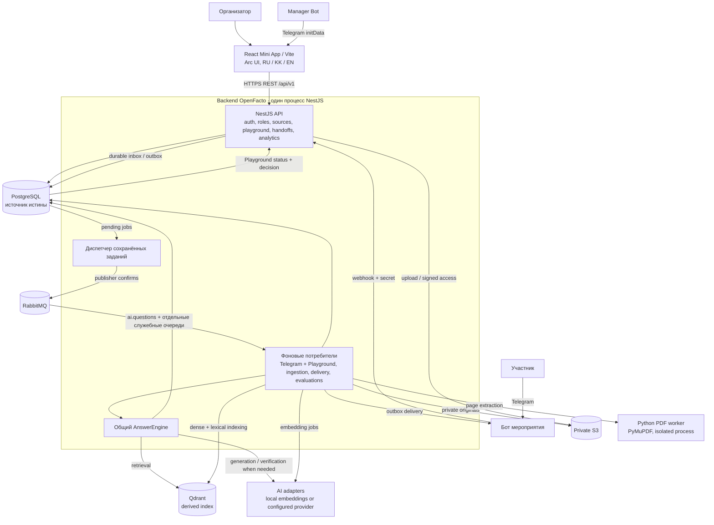
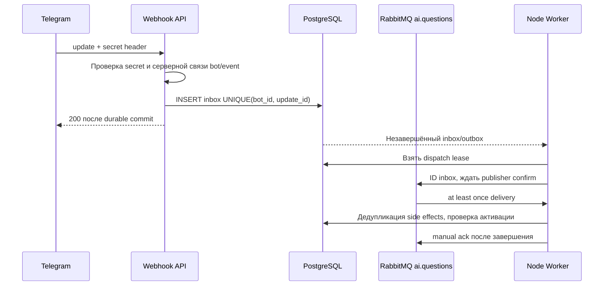
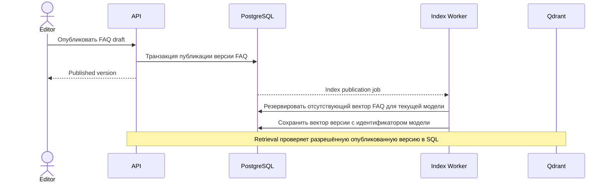
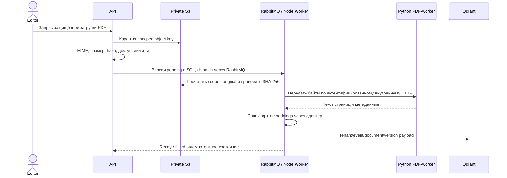
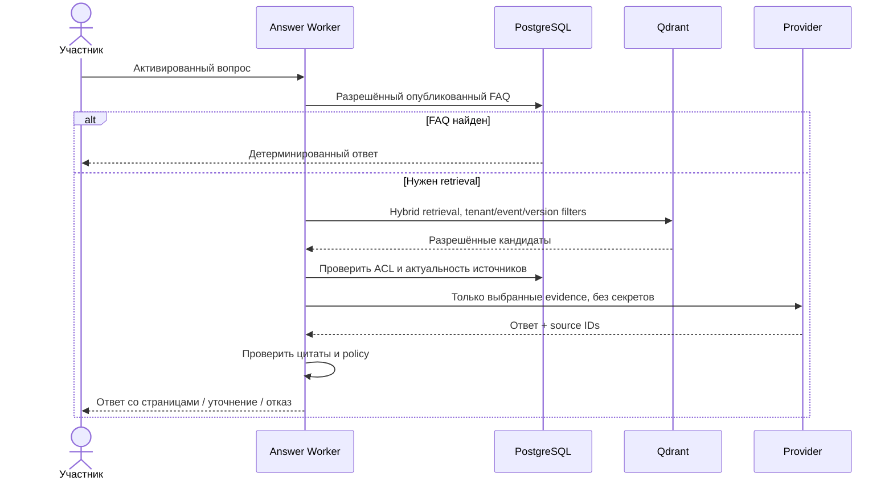

# Архитектура

Актуальное уточнение v2.0 от 8 ноября 2026: RabbitMQ и общая очередь AI. Этап 0 — локальный технический фундамент;
его статус и ограничения находятся в [VERIFICATION](VERIFICATION.md).

API и фоновые обработчики запускаются в одном NestJS-процессе. HTTP-обработчики
сохраняют задания в PostgreSQL; внутренний диспетчер публикует их в RabbitMQ,
а потребители того же бэкенда забирают сообщения. SQL остаётся источником истины:
периодический sweep восстанавливает уведомления после сбоя брокера. Telegram и Playground
проходят через одну физическую очередь `ai.questions` с общей границей параллелизма.
`apps/worker` — библиотека обработчиков, а не отдельный запускаемый сервис.



```mermaid
flowchart LR
  editor[Редактор] -->|FAQ draft or PDF| api[NestJS API]
  api -->|version, access and status| sql[(PostgreSQL)]
  api -->|private original| store[(Private S3)]
  sql -->|dispatch lease + index job| queue[(RabbitMQ)]
  queue --> ingest[Node ingestion worker]
  store -->|hash-checked bytes| ingest
  ingest --> extract[Python PDF extraction]
  extract -->|page text + diagnostics| ingest
  ingest -->|chunks + vectors| index[(Qdrant)]
  ingest -->|FAQ vector by published revision| sql
  participant[Question] -->|webhook / Playground POST| ingress[NestJS API]
  ingress -->|durable question| sql
  sql -->|dispatch lease| questions[(RabbitMQ ai.questions)]
  questions --> answer[AnswerEngine consumer]
  answer -->|exact FAQ + current ACL| sql
  answer -->|hybrid document retrieval| index
  answer -->|hydrate + recheck version| sql
  answer -->|answer claims + citations| verify[Evidence gate]
  verify -->|durable decision| sql
  sql -->|outbox| queue
  queue --> delivery[Delivery worker]
  delivery -->|recheck source, then send| participant
  sql -->|Playground GET status + trace| mini[Mini App]
  answer -->|insufficient / conflict / personal decision| handoff[Moderator handoff]
  handoff -->|response / optional FAQ draft| sql
  handoff -->|reply via outbox| delivery
 ```

SPA выполняет представление и обращения к REST. PostgreSQL — источник истины для прав,
публикаций, inbox/outbox, версий, трасс решений, бюджета и модерации. `playground_requests`
хранит автора, scope, исходный ввод, fingerprint, стабильный trace ID и состояние работы.
`queue_dispatches` хранит ограниченные по времени leases публикации, чтобы sweep не
заполнял очередь одинаковыми уведомлениями. RabbitMQ доставляет идентификаторы работ;
ожидающие записи восстанавливаются из SQL после потери очереди. Qdrant — производный
индекс с tenant/event/version scope; S3 хранит закрытые оригиналы. Node workers отдельно
обрабатывают ответы, индексацию и доставку внутри NestJS. PDF-parser работает в изолированном процессе.

Диспетчер ждёт publisher confirm; потребитель отправляет manual ack после завершения
обработчика. Неверные сообщения и необработанные ошибки уходят в `<queue>.dead`.
Повторы планируются по SQL-состоянию, времени следующей попытки и сроку claim lease.
После разрыва соединения транспорт восстанавливает topology и consumers. Доставка
at least once допускает дубликаты: SQL-проверки попытки и lease защищают фиксацию результата.
Это не гарантия exactly once для внешнего провайдера или Telegram. Неопределённый
платёж/отправка требует сверки по сохранённому состоянию. Текст вопросов и секреты
не помещаются в сообщения брокера.

Бизнес-API обслуживает сессии, организации, мероприятия, ботов, публикации, PDF,
Playground и обращения. HTTP Playground сохраняет работу и возвращает 202; LLM не
исполняется в HTTP-запросе. Consumer `ai.questions` использует общий AnswerEngine для
Telegram и Playground. `WORKER_CONCURRENCY` ограничивает их суммарный параллелизм в одном backend.
Отдельные очереди `documents.ingest`, `ai.evaluations` и `messages.delivery` обслуживают
индексацию, оценки и доставку. Обработка PDF вынесена в изолированный
процесс. Порядок поиска, допустимые исходы и границы доставки описаны в [AI-PIPELINE](AI-PIPELINE.md).

API readiness проверяет PostgreSQL и RabbitMQ. Доступность поиска по PDF, S3 и модели
проверяется в соответствующем сценарии. Точный FAQ обслуживается из SQL.
Liveness не обращается к зависимостям.

Следующие диаграммы описывают логические взаимодействия. Фактические HTTP-маршруты перечислены в [API](API.md).

```mermaid
sequenceDiagram
  actor Admin as Организатор
  participant SPA as Mini App
  participant API as NestJS
  participant DB as PostgreSQL
  Admin->>SPA: Открыть из Manager Bot
  SPA->>API: POST /api/v1/auth/telegram (initData)
  API->>API: HMAC, срок, replay policy, Manager Bot identity
  API->>DB: Найти user, создать server session
  API-->>SPA: Сессия без bot token
  SPA->>API: Запрос organization/event
  API->>DB: Проверка membership и tenant scope
  API-->>SPA: Разрешённые данные
```










Playground GET повторно проверяет автора, membership, событие и актуальность источников,
включая кандидатов в диагностическом следе. Результат и completed фиксируются атомарно.
Повторный POST с тем же ID и вводом возвращает текущее состояние без новой работы;
изменённый ввод конфликтует. Браузер опрашивает статус до пяти минут и сохраняет тот же ID
для повтора после таймаута. Offline sample остаётся локальным демонстрационным движком.

Перед запуском нового backend нужны миграции `0010_async_playground` и `0011_queue_dispatches`.
Старых BullMQ consumers следует остановить до перехода; незавершённые SQL-записи
подхватит новый диспетчер. Redis-данные автоматически не удаляются. Порядок перехода — в [RUNBOOK](RUNBOOK.md).

Релизы SPA и backend независимы; при этом переход Playground с синхронного решения на
POST 202 + GET требует согласованного обновления клиента и backend.
Void/Cloudflare — возможный будущий SPA target из v2.0; в этапе 0 не устанавливается
и не разворачивается. Backend, workers и данные остаются отдельным runtime.

UI: использовать **бесплатные Arc UI**, без покупки Pro-компонентов. Основа бренда —
[концепт 7](brand/CONCEPT-V7.md) и [его чистый знак](brand/SYMBOL-V7-CLEAN.md).
Ink `#26183E`, Glacier `#B8D5E8`, Paper `#F3EEE4`; растровый знак ещё не SVG-мастер.
Апрув логотипа не означает апрув макета: desktop/mobile-концепт согласуется на этапе 2
отдельно. Рабочий кабинет использует компоненты [Arc UI](https://uiarc.dev/) с локальными исходниками.
