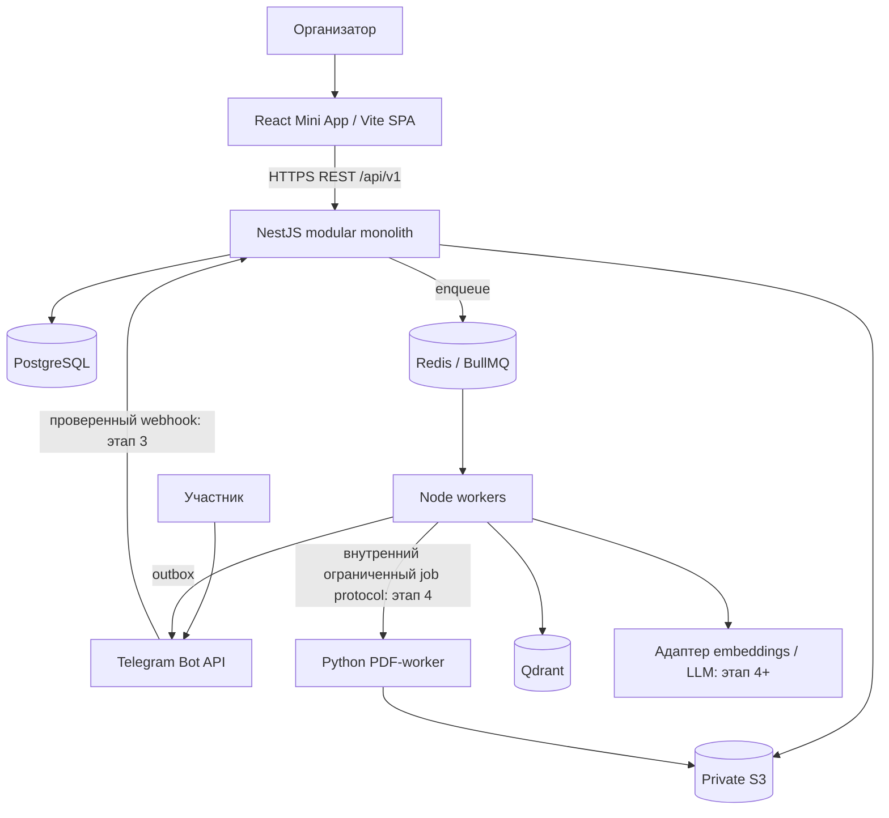
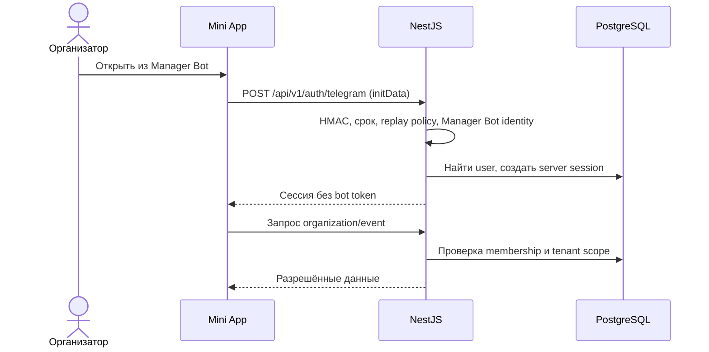
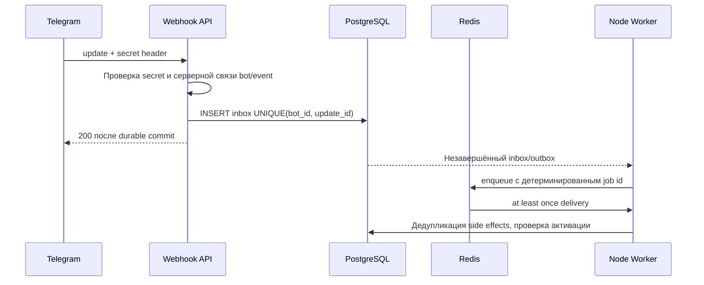
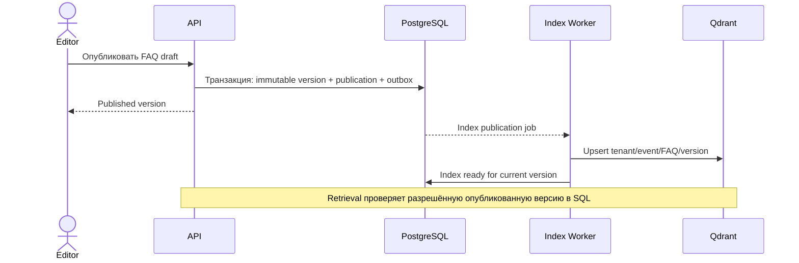
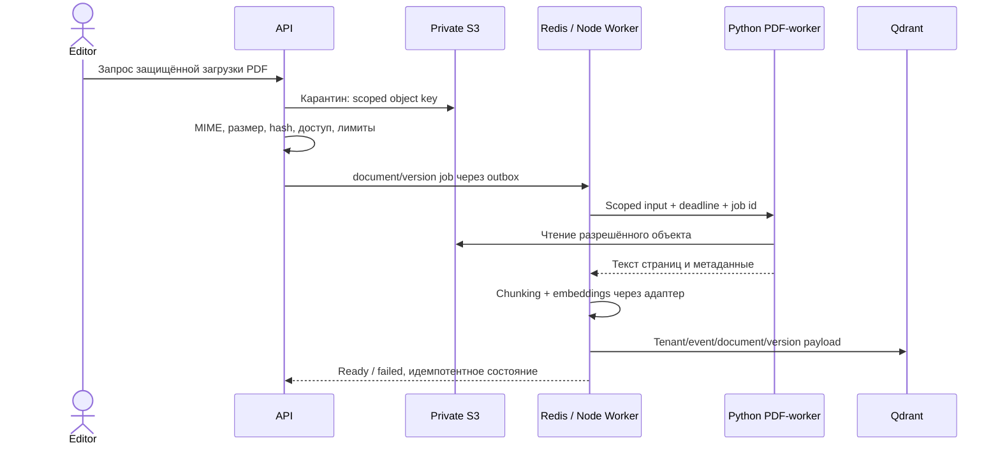
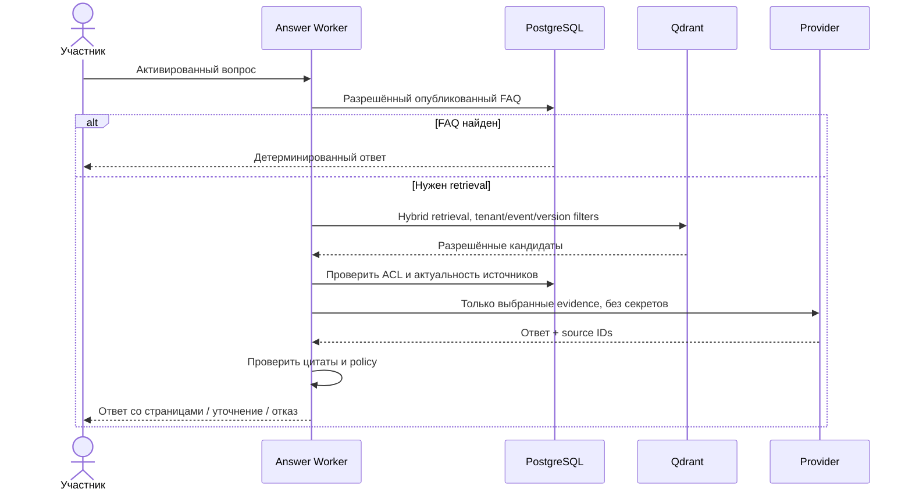
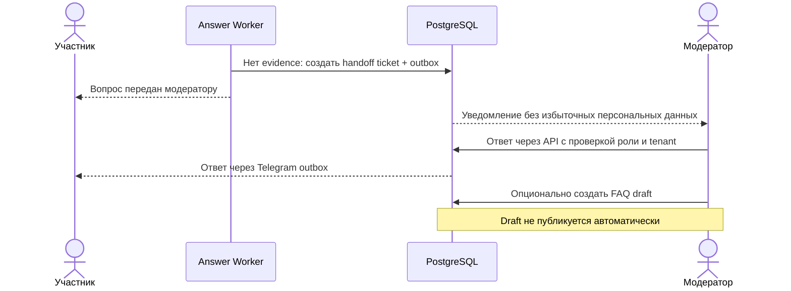

# Архитектура

Актуальное уточнение v2.0 от 7 ноября 2026. Этап 0 — локальный технический фундамент;
его статус и ограничения находятся в [VERIFICATION](VERIFICATION.md).

SPA выполняет только представление и обращения к REST. PostgreSQL — источник истины
для прав, публикаций, inbox/outbox и версий. Redis доставляет задачи; потеря Redis
не должна означать потерю бизнес-событий после реализации transactional outbox.
Qdrant — производный индекс с tenant/event/version scope; S3 хранит закрытые оригиналы.
Node workers обрабатывают фоновые задачи отдельно от HTTP. Python не исполняется внутри
Node; будет изолированным процессом с лимитами памяти, времени и размера PDF.

Сейчас бизнес-модули отсутствуют. Реализованы общие contracts/config/logger/database,
health-маршруты и smoke-очередь. Python предоставляет только lifecycle: `capabilities: []`.
PDF parsing, S3 upload, Qdrant indexing и внешние провайдеры ещё не подключены.

API readiness зависит от PostgreSQL и Redis. Qdrant/S3 не обслуживают ни один текущий
маршрут, поэтому их отказ не блокирует API этапа 0. Перед включением зависимого сценария
нужны отдельная worker readiness и политика деградации. Liveness не обращается к зависимостям.

Все следующие диаграммы описывают **запланированные** сценарии, а не существующие endpoints.

Релизы SPA и backend независимы; общий REST сохраняет обратную совместимость.
Void/Cloudflare — возможный будущий SPA target из v2.0; в этапе 0 не устанавливается
и не разворачивается. Backend, workers и данные остаются отдельным runtime.

UI: использовать **бесплатные Arc UI**, без покупки Pro-компонентов. Основа бренда —
[концепт 7](brand/CONCEPT-V7.md) и [его чистый знак](brand/SYMBOL-V7-CLEAN.md).
Ink `#26183E`, Glacier `#B8D5E8`, Paper `#F3EEE4`; растровый знак ещё не SVG-мастер.
Апрув логотипа не означает апрув макета: desktop/mobile-концепт согласуется на этапе 2
перед реализацией продуктовых экранов. Текущая SPA — нейтральный технический каркас.
