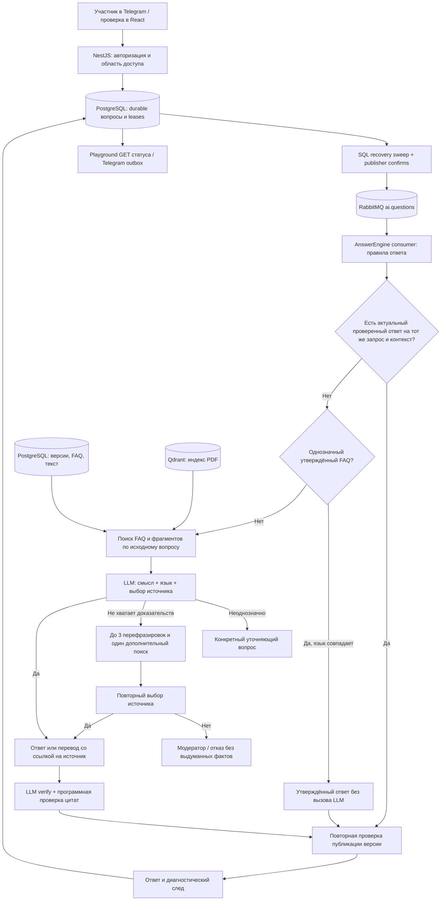

# Разговорный AI в OpenFacto

Это RAG (Retrieval-Augmented Generation): приложение ищет знания мероприятия и использует модель для ответа с опорой на найденное. Мы не обучаем собственную модель и не разрешаем ей придумывать правила мероприятия.

При программной проверке PDF-цитаты допускается разница только в пробельных символах (например, перенос строки вместо пробела). В независимую проверку и ссылки возвращается исходная цитата из документа. Изменения слов, чисел и пунктуации этим сопоставлением не разрешаются.

В Telegram язык ответа определяется по текущему сообщению (`languageSelection: auto`), включая смешанную речь, казахский без диакритики и латиницу. По умолчанию понимание и выбор источника объединены в один модельный этап; прежний отдельный `understand` доступен при `AI_COMBINED_PLANNING=0`. Язык Telegram-профиля служит запасной подсказкой. В Playground выбранный пользователем язык остаётся явным. Модель возвращает проверяемое поле `responseLanguage` (`ru`, `kk`, `en`); оно применяется к переводу, проверке и системным ответам.

Для Telegram единственный точный FAQ по исходному заголовку или утверждённому алиасу без истории возвращается без модели; язык берётся из этого FAQ. Такой же путь доступен для точного повтора последнего вопроса с тем же утверждённым ответом. Публикация версии проверяется перед ответом. При неоднозначности между несколькими FAQ этот путь не используется.

Ограниченная нормализация FAQ также учитывает казахскую латиницу, ввод без диакритики и разговорные вставки. Однозначное короткое продолжение о времени может вернуть тот же FAQ без модели, если все вопросы истории относятся к его утверждённым формулировкам/времени, а текущий FAQ явно содержит время. Ответ из истории не является доказательством. Дополнительные условия отключают этот путь; публикация проверяется перед выдачей. Правила, тесты и замеры — [FAQ-WORDING-FIX-2026-11-08.md](FAQ-WORDING-FIX-2026-11-08.md).

Для остальных вопросов язык определяет модельный этап. Если он явно подтвердил `contextIndependent: true` и не запросил уточнение, самостоятельный исходный вопрос может совпасть с точным FAQ даже после другой темы в истории — тогда дополнительная проверка моделью не требуется. При зависимости от истории и нерешённых персональных условиях остаётся полный путь. Поисковый пересказ модели никогда не может включить короткий путь. В явном режиме точный FAQ без истории по-прежнему не требует модели. Источники Telegram показываются отдельным блоком `Источники:`, `Дереккөздер:` или `Sources:`; для PDF указывается страница.

HTTP API и фоновые Node-обработчики выполняются внутри одного NestJS backend-процесса.
Одна его часть публикует сохранённые SQL-задания в RabbitMQ, другая получает и обрабатывает
их из брокера. Telegram и Playground используют одну физическую очередь `ai.questions`
с общей границей параллелизма. Отдельный Node worker запускать не требуется; Python извлекает текст PDF
в отдельном runtime. Общая схема находится в [ARCHITECTURE.md](ARCHITECTURE.md).

## Архитектура

Перед генерацией применяется кэш проверенных опубликованных ответов на 60 секунд: ключ содержит точный вопрос, полный контекст и снимок всех опубликованных источников мероприятия. Добавление/изменение/отзыв публикации инвалидирует результат. Одновременные идентичные запросы объединяются. Черновики, оценки качества, отказы и неподтверждённые ответы не кэшируются. Подробности и замеры — [CACHE-SPEED-CHECK-2026-11-08.md](CACHE-SPEED-CHECK-2026-11-08.md).



Например, «рега кайда болады?» сохраняется как исходный вопрос. Модель может предложить поисковые варианты «Где проходит регистрация?» и «Тіркелу қайда өтеді?». Поиск берёт материалы любого языка в текущем мероприятии. Если выбран русский FAQ, а язык ответа казахский, перевод проходит проверку по оригинальному FAQ. Переписанный запрос помогает найти материал, но не заменяет исходный вопрос при проверке ответа.

«А во ск?» после разговора о регистрации использует историю. Та же реплика без истории требует уточнения. «Рега?» тоже неоднозначна: человек может спрашивать место, время или способ регистрации. Неполные слова можно восстанавливать, только когда смысл достаточно понятен.

## Какие технологии за что отвечают

| Технология | Роль в проекте |
| --- | --- |
| TypeScript, React, Vite | Кабинет организатора и интерфейс проверки ответов |
| NestJS на Node.js | HTTP API, авторизация, управление материалами и проверка вопросов |
| PostgreSQL, Drizzle | Организации, мероприятия, версии знаний, сессии, история, расходы и миграции |
| RabbitMQ | Общая `ai.questions` для Telegram/Playground; отдельные очереди индексации, оценки и доставки |
| Python, PyMuPDF | Извлечение текста PDF по страницам |
| S3-совместимое хранилище | Оригиналы документов |
| Qdrant | Поиск по векторному и лексическому индексам PDF |
| Embeddings | Представление текста числами для сравнения по смыслу; модель/размерность задают совместимость индекса |
| LLM через HTTP-провайдер | Понимание речи, выбор ответа, перевод и проверка доказательств |
| Vitest, node:test, Playwright | Модульные, интеграционные и браузерные проверки |

FAQ-векторы хранятся в PostgreSQL по версии и модели; индекс PDF находится в Qdrant. При объединении результатов нескольких запросов используется RRF: важны позиции кандидата в разных выдачах. Фрагменты одной страницы различаются по chunkId, чтобы полезный абзац не исчезал при объединении.

Playground POST сохраняет вопрос и возвращает 202 с `requestId` и статусом
pending/running/completed/failed. Браузер опрашивает GET с обычной сессией автора;
завершённый ответ лежит в `decision`. LLM не вызывается внутри HTTP-обработчика.
При таймауте форма сохраняет тот же ID и исходный контекст для повтора; новое платное
задание ради проверки состояния не создаётся. Права и источники повторно проверяются
при выполнении и чтении. Перезагрузка страницы пока не восстанавливает ожидающую форму.

PostgreSQL остаётся журналом работ и попыток. Dispatch leases ограничивают повторную
публикацию, claim leases защищают обработку и фиксацию результата. RabbitMQ подтверждает
публикации, consumer вручную подтверждает завершённую обработку; ошибки и некорректные
сообщения изолируются в DLQ. После сбоя SQL sweep восстанавливает допустимые задания.
At least once означает возможные дубликаты, а не exactly once для провайдера или Telegram.

Память ограничена тремя репликами и десятью минутами. В Telegram она привязана к организации, мероприятию, боту, чату, теме и пользователю. В кабинете сбрасывается при смене мероприятия, режима источников, языка и по кнопке «Новый диалог». История помогает понять вопрос; факты для ответа всё равно нужны из доступных источников.

## Где смотреть код

- `packages/answer-engine/src/index.ts` — решения и правила доверия к источникам.
- `apps/worker/src/understanding.ts` — инструкция понимания речи и проверка JSON модели.
- `apps/worker/src/provider.ts` — вызовы understand/select/verify, бюджет и учёт расходов.
- `apps/worker/src/answers.ts` — поиск в текущем мероприятии.
- `apps/worker/src/retrieval-ranking.ts` — объединение результатов поиска.
- `apps/worker/src/telegram.ts` — контекст Telegram и доставка.
- `apps/worker/src/business.ts` — SQL recovery и dispatch в очереди RabbitMQ.
- `apps/worker/src/playground-jobs.ts` — выполнение Playground с lease и фиксацией решения.
- `packages/queue/src/index.ts` — confirms, manual ack, reconnect и DLQ.
- `apps/api/src/product/playground.ts` — сохранение запроса, GET статуса и защита повторов.
- `apps/mini-app/src/Testing.tsx` — форма и история диалога.
- `apps/mini-app/src/playground.ts` — ограниченный опрос статуса и сетевые повторы с тем же ID.

## Как запустить самому

Нужны установленные зависимости, заполненный корневой `.env`, Docker-инфраструктура и настроенный AI-провайдер. Пароли и ключи остаются в `.env`; не отправляй его целиком в чат.

```powershell
pnpm infra:up
pnpm build
pnpm db:migrate
pnpm dev:local
```

При переходе с BullMQ сначала останови старые consumers. Перед новым backend обязательны
миграции `0010_async_playground` и `0011_queue_dispatches`; задай `RABBITMQ_URL` и
согласованные `RABBITMQ_DEFAULT_USER`/`RABBITMQ_DEFAULT_PASS` по [RUNBOOK](RUNBOOK.md).
Старые SQL-задания восстанавливаются новым sweep; Redis volumes не удаляются автоматически.
`dev:local` проверяет и при необходимости запускает локальный semantic runtime на
127.0.0.1:7312, если он выбран через `EMBEDDING_URL`. Его Python-окружение и веса
подготавливаются отдельно; существующая настройка semantic-модели сохраняется.

Открой http://127.0.0.1:55173. Локальный запуск создаёт тестовый кабинет с тремя опубликованными FAQ и обращается к настоящему API. API слушает 127.0.0.1:53000. При необходимости порты меняются через LOCAL_API_PORT и LOCAL_APP_PORT. DATABASE_URL должен указывать на локальный PostgreSQL. После перезапуска API новый локальный вход создаёт отдельный тестовый кабинет; сохранённая действующая сессия продолжает открывать свой кабинет.

Локальный вход доступен только при явном флаге development, loopback-привязке API/БД/интерфейса и совпадении Origin/Host. Он не включается в production-сборке интерфейса. Режим обычного offline sample не вызывает AI; это демонстрация интерфейса, поэтому нельзя использовать его для оценки понимания речи.

## Как проверять изменения

```powershell
pnpm check
pnpm test:integration
pnpm test:e2e
pnpm check:spa
```

Интеграции запускай на отдельной тестовой БД с миграциями: они создают тестовые записи. Для отдельной проверки разговорной речи с реальными платными вызовами, в пределах настроенного бюджета:

```powershell
$env:OPENFACTO_TEST_WIKIVIBE='1'
node --env-file=.env --test apps/worker/test/conversation-live.integration.mjs
```

Набор проверяет исходный пример со скриншота, RU/KK, транслитерацию, обрыв слова, неоднозначность, уточнение по истории, отрицание и личное исключение. 7 ноября 2026 все 10 сценариев прошли на настроенной модели. Это небольшой регрессионный набор, а не гарантия понимания любых вариантов речи. Чтобы измерять качество, добавляй реальные обезличенные вопросы с ожидаемым источником и решением, включая случаи, когда отвечать нельзя. Сравнивай долю правильных ответов, неподтверждённых ответов, уточнений, задержку и стоимость.

Браузерная проверка запущенного `dev:local` (Chrome, реальные AI-вызовы):

```powershell
$env:LOCAL_BROWSER_TEST_URL='http://127.0.0.1:55173'
node --test apps/mini-app/test/conversation.browser.mjs
```

Исторический итог внедрения разговорного контекста от 7 ноября 2026, до перехода на
RabbitMQ: `pnpm check` прошёл (75 unit-тестов, линтер, типы, сборка), 3 API-интеграции,
4 worker-интеграции, 9 API e2e, 10 живых AI-сценариев и браузерный сценарий прошли.
Браузер проверил ответ с источником, уточнение по истории, RU/KK, сброс и отсутствие
горизонтального переполнения на ширине 390 px. Проверка SPA не обнаружила серверных
ключей в собранных ресурсах. Настоящая доставка в Telegram этим прогоном не подтверждена:
токен Manager Bot в окружении не задан. Эти результаты не подтверждают новый транспорт;
приёмка RabbitMQ и асинхронного Playground фиксируется отдельным прогоном.

Для обучения: сначала проследи один запрос от формы до источника, затем измени поисковую формулировку и сравни найденные фрагменты, после этого добавь сложный пример в evaluation. Так видно, где ошибка: понимание, поиск, генерация или проверка. Дообучение имеет смысл рассматривать после измерения этих отдельных этапов.
