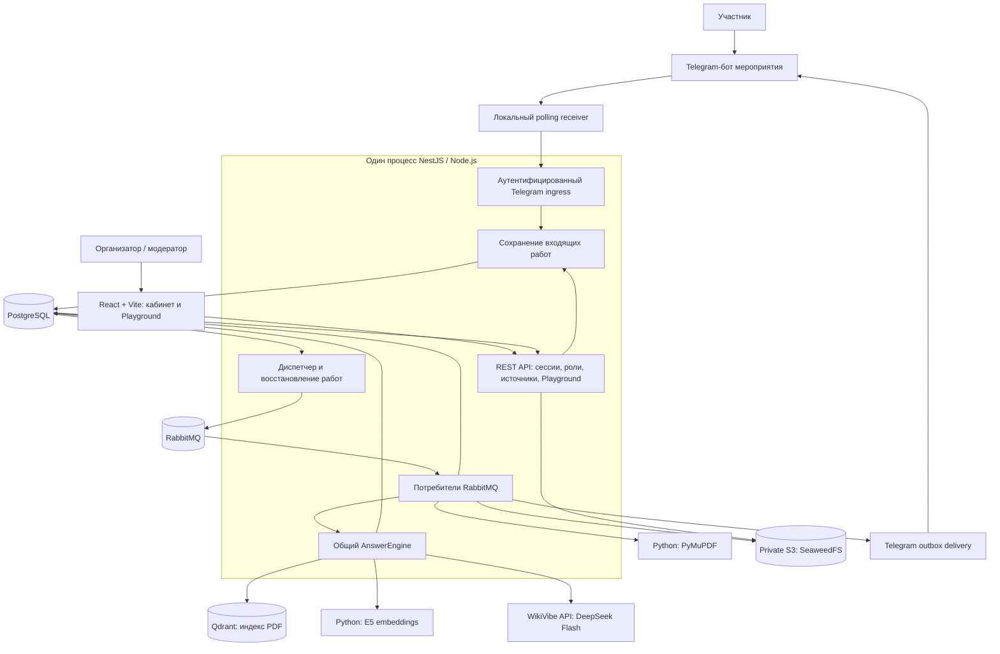
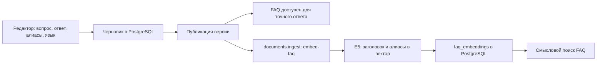
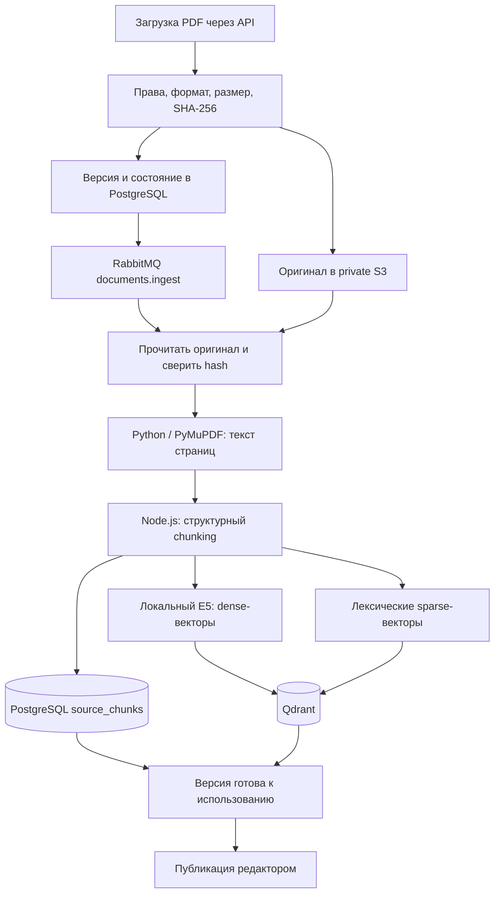
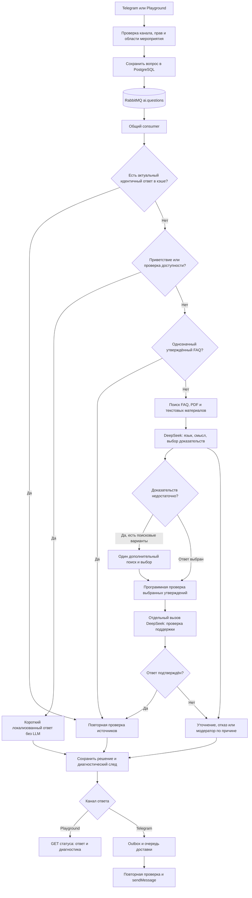

# OpenFacto: текущая архитектура и полный pipeline

Состояние локального проекта на 8 ноября 2026. Описана текущая реализация, включая DeepSeek, RabbitMQ и исправления смешанного казахского и коротких продолжений.

## 1. Общая архитектура

OpenFacto — модульный backend с общей RAG-логикой. API и фоновые Node-обработчики работают внутри одного NestJS-процесса. `apps/worker` — библиотека обработчиков, подключённая к backend. Python-процессы извлечения PDF и локальных embeddings запускаются отдельно.



Вариант входа через внешний HTTPS webhook реализован тем же ingress. Текущий локальный стенд использует polling.

## 2. Технологии

| Слой | Технология | Назначение |
|---|---|---|
| Интерфейс | React, TypeScript, Vite | Обзор, источники, Playground, обращения, настройки |
| UI | CSS, Motion, Phosphor, Montserrat | Компоненты, состояния, иконки, графитовая тема, адаптивность |
| Backend | NestJS на Node.js | HTTP API, авторизация, роли, управление знаниями, фоновые обработчики |
| Данные | PostgreSQL 18, Drizzle, SQL migrations | Источники истины, версии, права, задания, результаты, расходы |
| Очереди | RabbitMQ 4, amqplib | Задания AI, индексации, доставки и оценки качества |
| Индекс документов | Qdrant | Dense/sparse поиск PDF-чанков с фильтрами области доступа |
| Объектное хранилище | SeaweedFS с S3 API | Закрытые оригиналы PDF |
| Извлечение PDF | Python 3.12+, PyMuPDF | Постраничный текст и диагностика извлечения |
| Embeddings | Python, PyTorch CPU, sentence-transformers | Локальные векторы текстов и вопросов |
| Активная embedding-модель | `intfloat/multilingual-e5-small`, 384 измерения | Многоязычный смысловой поиск |
| Генерация и проверка | `deepseek-v4.1-flash` через WikiVibe | Смысловой выбор, переводы, утверждения, отдельная проверка |
| Кэш | Память процесса Node.js | Краткое переиспользование проверенных ответов |
| Монорепозиторий | pnpm, Turborepo | Зависимости, сборка и общие пакеты |
| Проверки | Vitest, Node test runner, Oxlint, TypeScript | Регрессии, интеграции, качество кода |
| Локальная инфраструктура | Docker Compose | PostgreSQL, RabbitMQ, Qdrant, SeaweedFS |

Нейронный reranker `cross-encoder/mmarco-mMiniLMv2-L12-H384-v1` доступен как опция. Сейчас `RERANK_URL` не задан, поэтому этот отдельный этап выключен. Базовое ранжирование и объединение выдачи работают.

## 3. Что где хранится

| Хранилище | Данные |
|---|---|
| PostgreSQL | Организации, мероприятия, пользователи, роли, боты, исходные вопросы, публикации, история, результаты, outbox, модерация, расходы |
| `knowledge_sources` | Рабочие карточки FAQ и документов |
| `source_versions` | Снимки версий знаний, язык, доступ, состояние обработки |
| `source_chunks` | Текст PDF-чанков, страница, порядок, источник и версия |
| `faq_embeddings` | Векторы заголовков и алиасов FAQ, привязанные к версии и embedding-модели |
| Qdrant | Dense/sparse векторы PDF-чанков и метаданные области поиска |
| S3 | Оригинальные PDF |
| RabbitMQ | Небольшие уведомления с ID заданий |
| Память Node.js | Ограниченный кэш подтверждённых ответов |

FAQ-векторы сейчас хранятся как нормализованные массивы `real[]` в PostgreSQL; сходство считается скалярным произведением. Текст ответа берётся из текущей версии FAQ.

Коллекция Qdrant определяется конфигурацией embedding-модели. Организации и мероприятия разделяются фильтрами `organizationId`, `eventId`, `versionId`. Текст, возвращаемый пользователю, дочитывается и повторно проверяется в SQL.

## 4. Как знания попадают в RAG

### FAQ



Точный опубликованный FAQ не обязан ждать смысловой индексации.

### PDF



Готовность индекса и публикация — разные состояния. Черновик или внутренний документ не становится доступным участнику только потому, что обработка закончилась.

### Chunking

- Сначала сохраняются страницы, абзацы, строки списков/таблиц и границы предложений.
- Ориентир размера — до 1000 символов строки, а не 1000 токенов.
- Заголовок при необходимости повторяется для контекста.
- Для патологически длинных предложений применяется разрезание с перекрытием около 120 символов.
- Чанк не переносится через границу страницы.
- При поиске могут добавляться соседние чанки той же страницы и версии.
- ID чанка зависит от версии алгоритма, версии документа, порядка и текста.

Так модель получает ограниченные фрагменты с контекстом и страницами для ссылок.

## 5. Общий pipeline вопроса



### Быстрые пути: 0 LLM-вызовов

1. Приветствие: например, «лол как дела».
2. Точный опубликованный FAQ или утверждённый алиас.
3. Ограниченные варианты казахского написания и разговорные вставки: `тіркелу кайда сучка`, `tirkelu qaida bolady blya`.
4. Однозначное продолжение о времени: `а во ск бля` после утверждённого вопроса о регистрации, если текущий FAQ явно содержит время.
5. Актуальный проверенный ответ из кэша.

История определяет тему, но не является доказательством. Даты, отрицания, роли и просьбы об исключении не удаляются нормализатором. Новые условия отключают соответствующий быстрый путь.

### Поиск для остальных вопросов

| Ветка | Как работает |
|---|---|
| FAQ | Вектор вопроса E5, сходство с FAQ-векторами в PostgreSQL, лексический сигнал |
| PDF | Dense + sparse поиск Qdrant, объединение RRF, дополнительный полнотекстовый поиск PostgreSQL |
| Текстовые материалы | Чанки из версионного текста PostgreSQL и лексическое ранжирование |

Ветки FAQ и PDF запускаются параллельно. В полнотекстовом поиске используются русский стемминг и ограниченные префиксы. Слова названия мероприятия исключаются из поисковых терминов, чтобы одинаковые заголовки не вытесняли редкий пункт регламента. Лучшие результаты уточнённых запросов сохраняются при объединении.

### Выбор и независимая проверка

Обычно используются два отдельных вызова **той же DeepSeek Flash**:

1. **Select:** определить язык/смысл и выбрать FAQ либо сформировать утверждения с цитатами из документов.
2. **Verify:** проверить полный исходный вопрос, условия, доказательства, язык и применимые противоречия.

Для FAQ на нужном языке возвращается утверждённый текст. Для другого языка модель предлагает перевод, который проверяется по исходному FAQ. Для PDF программно проверяется, что цитата присутствует в разрешённом фрагменте; допускаются только различия в пробелах/переносах.

Если доказательств мало, допускается один дополнительный поиск по 1–3 перефразировкам. Оригинальный вопрос остаётся главным; перефразировка не является источником фактов.

Если цитата отсутствует в выбранном документе, допускается одна попытка исправить выбор из того же разрешённого списка. Все проверки выполняются снова. Бесконечного перебора до положительного вердикта нет.

Вопрос вне тематики, уточнение или личное исключение может завершиться после первого модельного выбора. Успешный смысловой ответ обычно требует двух вызовов; расширение поиска и исправление цитаты иногда добавляют вызовы. Старый отдельный этап понимания доступен через `AI_COMBINED_PLANNING=0` для сравнений.

## 6. Telegram

Текущий локальный путь:

```text
Участник
  → Telegram getUpdates
  → scripts/telegram-polling.mjs
  → localhost ingress с секретом
  → PostgreSQL inbox
  → RabbitMQ ai.questions
  → processUpdate + AnswerEngine
  → PostgreSQL decision / handoff / outbox
  → RabbitMQ messages.delivery
  → проверка контекста и публикаций
  → Telegram sendMessage
```

Приёмник подтверждает offset только после успешного сохранения update через ingress. Дубликаты защищены уникальностью `(bot_id, update_id)`.

В режиме группы `mention_or_name` бот активируется по `/ask`, упоминанию username, ответу на сообщение бота или настроенному имени «лол». Также проверяется разрешённый chat ID. Для получения обычных групповых сообщений Privacy Mode ранее отключён.

История привязана к боту, чату, теме и пользователю, хранит до трёх последних пар вопрос/ответ и истекает через 10 минут. Социальные реплики не заменяют содержательный контекст. Язык Telegram определяется автоматически; язык профиля — запасная подсказка.

Обычный FAQ не перегружается блоком ссылок. Для документов и значимых правил может показываться компактный источник со страницей. Полные ссылки и версии сохраняются в диагностике.

## 7. Playground

```text
React
  → POST /api/v1/organizations/:org/events/:event/playground
  → авторизация, проверка режима и requestId
  → PostgreSQL playground_requests
  ← HTTP 202 Accepted

Диспетчер → RabbitMQ ai.questions → тот же AnswerEngine
  → результат в PostgreSQL

React
  → GET .../playground/:requestId
  ← статус, ответ, источники, trace и расход
```

LLM не исполняется внутри долгого HTTP POST. С тем же requestId и тем же вводом возвращается текущее состояние; изменение ввода с тем же ID конфликтует. При чтении повторно проверяются автор, права и актуальность источников.

Язык ответа выбирается явно. Режимы: `published_preview`, `draft_preview`; служебные оценки используют `evaluation`, Telegram — `live`. Проверка Playground не отправляет сообщение в Telegram и не создаёт настоящее обращение участника.

## 8. Очереди и восстановление

| Очередь | Работы | Конкурентность текущего экземпляра |
|---|---|---:|
| `ai.questions` | Telegram + Playground | 2 суммарно |
| `documents.ingest` | PDF ingest, purge, embed-faq | 1 |
| `messages.delivery` | Отправка Telegram outbox | 2 |
| `ai.evaluations` | Контрольные AI-проверки | 1 |
| `openfacto-foundation` | Техническая smoke-проверка брокера | Отдельное техническое назначение |

Каждая основная очередь имеет `.dead` для некорректных сообщений и необработанных ошибок.

Пример сообщения:

```json
{"name":"telegram","data":{"id":"uuid-записи-inbox"}}
```

В брокере нет полного вопроса, текста PDF или ключа модели. Обработчик восстанавливает данные и scope из SQL.

- SQL хранит состояние работы, lease и попытки.
- Диспетчер ждёт publisher confirm RabbitMQ.
- Потребитель использует manual ack после завершения обработчика.
- `queue_dispatches` ограничивает повторные публикации.
- Периодический recovery sweep восстанавливает ожидающие работы.
- `prefetch` и локальная граница конкурентности ограничивают число активных заданий.

Гарантия доставки — **at least once**. SQL-защита от дубликатов не превращает внешний вызов модели или Telegram в exactly once. Неопределённый результат отправки/платного запроса сохраняется как uncertain и требует сверки.

## 9. Кэш и скорость

Кэш живёт в памяти backend: TTL 60 секунд, до 128 записей на экземпляр кэша. Ключ учитывает точный вопрос, всю историю, организацию/мероприятие, режим, язык, модели, настройки и снимок публикаций.

При попадании в кэш источники проверяются снова. Изменение или добавление публикации инвалидирует результат. Идентичные одновременные запросы объединяются. Отказы, уточнения, черновики и оценки качества не кэшируются. Смена истории означает другой ключ; любой повтор сообщения не обязательно является попаданием в кэш.

Последние замеры исправленных вопросов:

| Путь | Замер |
|---|---:|
| Исправленные FAQ/контекст, внутри движка | Медиана 3 мс, p95 12 мс |
| Холодный HTTP → RabbitMQ → ответ для них | 148–303 мс |
| Полный набор из 40 разных сценариев | Медиана 2613 мс, p95 8242 мс |

В последнюю строку входят и быстрые ответы, и внешние модельные запросы. Доставка Telegram в HTTP-замеры не включена. Фиксированного SLA для любого вопроса эти результаты не дают.

## 10. Безопасность и модерация

- Серверные сессии, роли и изоляция организаций/мероприятий.
- Участнику доступны только опубликованные материалы с подходящей видимостью.
- Повторная проверка версии перед ответом и отправкой.
- Ключи остаются на сервере; bot token хранится зашифрованным.
- Вопрос, история и документы считаются недоверенными данными для LLM.
- JSON-ответ модели, индексы кандидатов, цитаты, язык и usage проверяются программно.
- До платной операции SQL резервирует оценку бюджета; после сохраняются usage и стоимость.
- Трасса содержит traceId, outcome, reasonCode, версии источников, этапы, время и расход.

При нехватке фактов, конфликте или необходимости личного решения применяется уточнение/модерация по причине и настройкам. Модератор отвечает через кабинет; ответ уходит через outbox. Превращение ответа в FAQ и его публикация выполняются отдельно.

## 11. Структура проекта

```text
apps/
  mini-app/        React-интерфейс
  api/             NestJS API и запуск фоновых обработчиков
  worker/          Библиотека answer/ingestion/delivery/evaluation handlers
  pdf-worker/      Python + PyMuPDF
  semantic-worker/ Python + E5, опциональный reranker
packages/
  answer-engine/  Политика ответа, FAQ, контекст, проверка утверждений
  queue/          RabbitMQ transport и контракт уведомлений
  database/       Схема, миграции и работа с данными
  contracts/      Общие контракты
  config/         Конфигурация
  logger/         Логирование
scripts/
  dev-local.mjs
  telegram-polling.mjs
compose.yaml
```

В локальном стенде четыре инфраструктурных Docker-сервиса; frontend, NestJS, polling receiver и два Python-сервиса запускаются отдельными процессами. В production Vite dev server заменяется размещением статической сборки frontend; внешняя публикация и HTTPS настраиваются отдельно.

## 12. Текущее подтверждение

Исходный живой набор: 40/40; дополнительные проверки исправленных вариантов: 48/48; холодный HTTP-путь: 3/3. `pnpm check`: сборка, линтер, типы и 295 JS/TS-тестов. Затронутые AI/SQL-интеграции: 6/6.

Подробности: [FAQ-WORDING-FIX-2026-11-08.md](FAQ-WORDING-FIX-2026-11-08.md), [API.md](API.md), [LOCAL-TELEGRAM.md](LOCAL-TELEGRAM.md).
