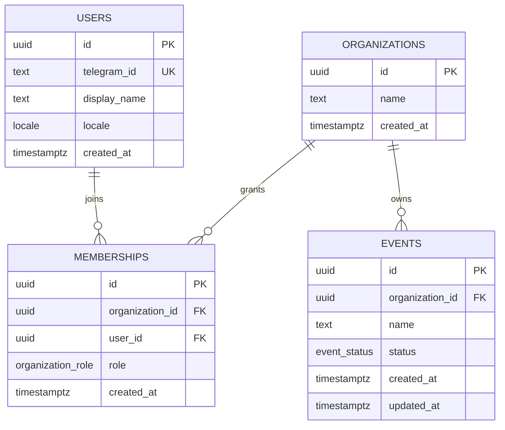

# Модель данных

Реализованы `packages/database/src/schema.ts`, SQL baseline `drizzle/0000_foundation.sql`,
journal/snapshot и Postgres.js Drizzle migrator. Источник истины для следующих изменений —
Drizzle schema + проверенная миграция; `push` не используется в CI/production.
Baseline подтверждён Drizzle generator без diff. Migrator дважды применён на новой
пустой PostgreSQL 18.6; SQL/ORM integration прошёл в основной и чистой копиях проекта.

| Таблица | Ограничения и назначение |
| --- | --- |
| users | UUIDv4 default; telegram_id text UNIQUE с CHECK положительной десятичной строки; locale ru/kk/en |
| organizations | Непустое name; owner определяется membership, не отдельным дублирующим полем |
| memberships | UNIQUE(organization_id,user_id), FK, роли owner/admin/editor/moderator/viewer; default viewer |
| events | FK organization_id; status draft/active/archived; default draft; непустое name |

UUID создаются PostgreSQL `gen_random_uuid()` (v4). `timestamptz` хранит момент времени;
Compose PostgreSQL и клиентская connection timezone — UTC, JSON даты сериализуются в ISO.
Telegram user ID не приводится к JavaScript Number или SQL integer. Отрицательный Telegram
chat ID будет отдельным полем будущей chats-таблицы с собственным signed decimal CHECK.

`created_at` задаёт БД; `events.updated_at` пока имеет только insert default.
Сервер обязан обновлять его при изменении события на этапе 1; общего UPDATE endpoint пока нет.
FK каскадируют связи при удалении организации/пользователя; политика destructive удаления,
удержания данных и последнего owner реализуется в сервисах этапов 1/6, а не SQL foundation.

Индексы: unique Telegram ID; unique organization/user membership; memberships user_id;
events `(organization_id,id)`. Листинги, поиск и audit индексы добавляются по реальным запросам.

**Tenant isolation пока не реализована.** UUID и FK не являются контролем доступа.
Этап 1 добавит обязательный TenantContext из сессии и проверенной membership, запрет
unscoped repository paths, negative integration tests для чужих organization/event.
Platform Owner — отдельное platform-level полномочие, не organization role.
Event-scoped grants и ограничения moderator появятся с соответствующими сценариями;
они не должны неявно расширять organization permissions.

Будущие сущности: sessions, bots/credentials, chats, inbox/outbox (этапы 1/3), FAQ drafts,
immutable FAQ versions/publications (3), documents/document versions/chunks/index jobs (4),
answers/source references/handoff tickets/moderator replies (5), usage/budgets/audit/eval runs (6).
Во всех tenant-сущностях — organization_id, event_id где применимо, tenant-consistent
FK/unique constraints. Worker payload содержит scope и версию; worker перепроверяет их в БД.
Qdrant и S3 не заменяют SQL authorization.

Миграции применяются отдельной командой `pnpm db:migrate`, не при старте API.
Повторное применение использует Drizzle journal. В CI миграция запускается дважды на
чистой БД; integration test проверяет UUID, exact Telegram ID round-trip, unique membership,
FK, CHECK и cascade. Перед следующим schema change выполнить `db:generate` и изучить полученный diff.
Postgres.js raw timestamps после регистрации Drizzle возвращаются строками; date-mode
колонки ORM преобразуются в Date. Это различие проверено integration test через
`database.db.transaction`, включая UTC и последующую сериализацию ISO.
