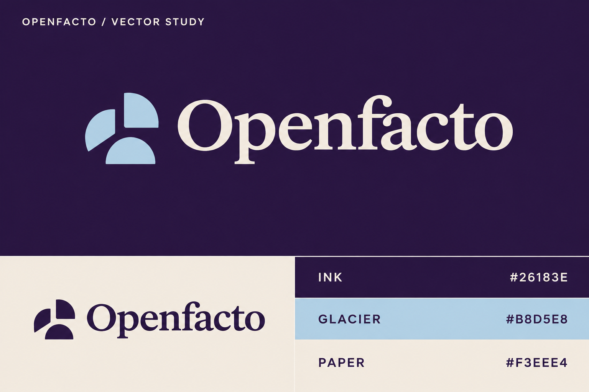

# Openfacto — сочетание референсов, v7

Статус: концепция на согласование, не финальный бренд. Встроенный imagegen. Референсы: Fractional и геометрический знак/леттеринг из изображения пользователя. Задача — совместить читаемую антикву первого с модульной геометрией второго; символически передать направления поиска, сходящиеся к ответу. Растровый знак пока абстрактен: трактовка вектора — намерение концепции, а не утверждение пользователя.



Ровно три базовых цвета: Ink #26183E, Glacier #B8D5E8, Paper #F3EEE4. Текстовые HEX — источник истины; растровая генерация может давать тональные отклонения. Перед применением нужен точный векторный мастер SVG. Фронтенд не менялся; его визуальная концепция требует отдельного апрува, реализация на бесплатных Arc UI.

## Точный промпт

```text
Use case: logo-brand
Asset type: refined original Openfacto logo + exactly three-color palette approval sheet.
Input images: Image 1 is reference A, elegant Fractional editorial serif wordmark with small geometric symbol on ivory. Image 2 is reference B, compact playful rounded modular symbol and rhythmic geometric lettering on deep violet. Combine the best attributes: highly readable editorial wordmark from A, sculptural geometric small emblem and strong flat color contrast from B. Do not copy either logo, word, F symbol or humanoid symbol.
Primary request: design one EXCELLENT carefully proportioned original Openfacto brand lockup, not a collection of random logo variations. Product meaning: vector search through official knowledge sources converges on one confirmed answer. The user specifically wants the idea of a VECTOR incorporated.
Symbol design: a compact ORIGINAL abstract directional monogram using exactly three rounded wedge/quarter-circle solid pieces aligned toward one small central negative-space point. The silhouette subtly suggests a forward/upward vector and an open O without looking like a play button, recycling, pinwheel or flower. Think precise geometric wayfinding and vector-space convergence. Rounded solid geometric masses, elegant limited complexity, beautiful balanced negative space, not thin node networks. Small emblem height equal to the capital O in the wordmark, never enormous. Vector-friendly flat geometry.
Wordmark EXACT TEXT: "Openfacto", capital O, rest lowercase, all letters intact. Elegant contemporary soft editorial serif, moderate contrast, subtly rounded terminals and generous open counters. Distinctive but very readable. Do NOT break all letters into stencils, no circular illegible alphabet. Give the f-t region tasteful custom ligature shaping but keep it readable. Careful optical kerning, not generic default Times New Roman. Emblem to the left with generous intentional spacing.
EXACTLY THREE BASE COLORS throughout: Deep Plum #26183E, Glacier Blue #B8D5E8, Warm Paper #F3EEE4. No pink, green, orange, mint, electric cyan, lavender swatch, black or white added. Flat solid fills, no gradients, textures, shadows, glow or 3D.
Composition: landscape 3:2 minimalist professional brand presentation with precise 24px gutters and ample breathing room. Upper two thirds: deep-plum panel, centered large Glacier Blue emblem and Warm Paper Openfacto wordmark. Very small paper label top left "OPENFACTO / VECTOR STUDY". Lower third split into two equally sized rectangles: left Warm Paper panel showing smaller monochrome Deep Plum lockup (same EXACT emblem and typography as hero, not a different design), right a clean three-row palette strip: Deep Plum with "#26183E" label in paper, Glacier Blue with "#B8D5E8" label in plum, Warm Paper with "#F3EEE4" label in plum. Optional tiny category labels "INK", "GLACIER", "PAPER" only. Only 3 swatches total.
Constraints: no UI mockups, no slogans, no explanatory diagrams or arrows, no business cards, no fake device mockups, no extra symbols beyond the one approved design exploration. Premium calm crafted identity. Match first reference's editorial elegance and second reference's modular geometric confidence, while making the emblem meaningfully about a vector toward a sourced answer. This is an original draft for approval.
```

